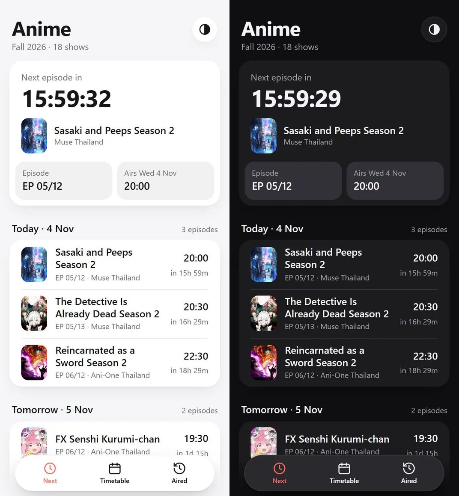
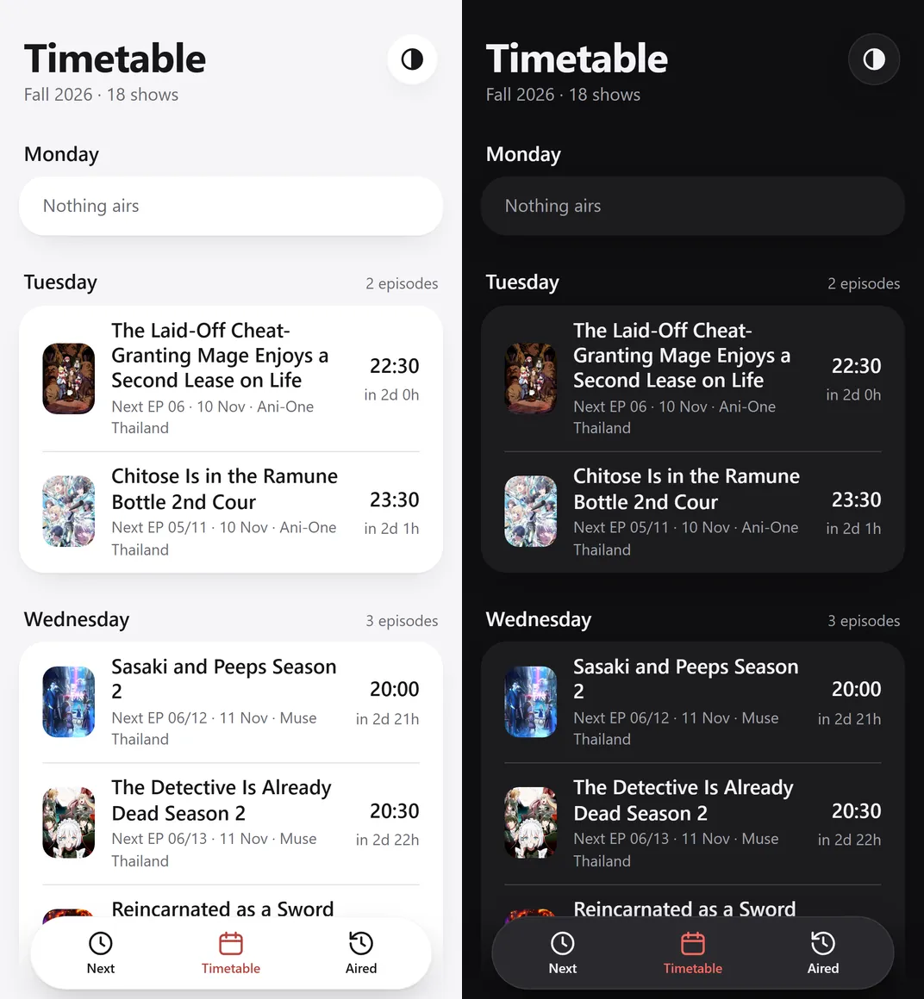
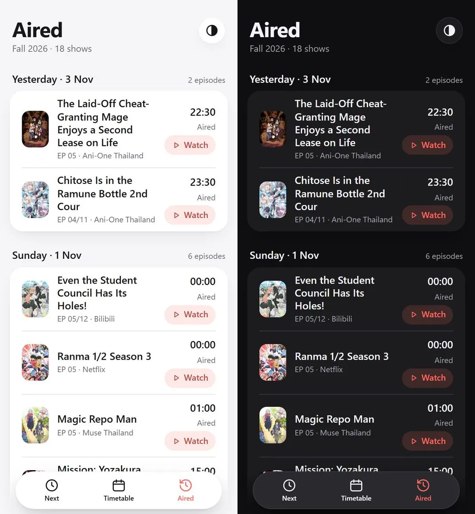
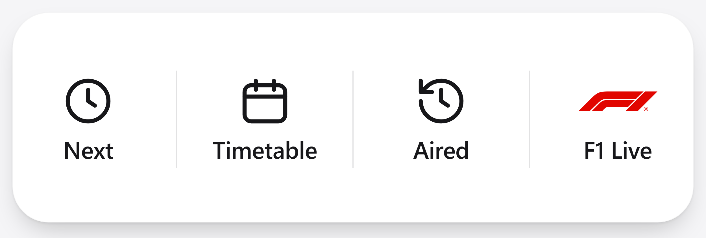

# Alert Watch

Sends a LINE message (official account **Alert Watch**) when a tracked manga chapter, Webtoon episode or anime episode comes out, and after every Formula 1 session. It runs on GitHub Actions, so it works with your Mac off.

- **Website:** https://isaraapae.github.io/alert-watch/anime/ (the old address, https://isaraapae.github.io/alert-watch/, forwards there; the move gave iPhone Safari a fresh address after it had remembered "no icon" for the old one). In the same style as [ป้าคีน](https://github.com/IsaraApae/paakeen): a floating menu (Next, Timetable, Aired) and a round Appearance button at the top. It has a countdown to the next episode and the next 7 days (**Next**), a Monday–Sunday **Timetable** (`?v=week`), and the episodes that aired in the past week with their Watch buttons (**Aired**, `?v=aired`). An episode's Watch button appears once its LINE card is out, never before (a YouTube premiere waits until it plays). A finished show leaves the site once its last episode is over a week old. Times are Thai time.
- **F1 Live:** https://isaraapae.github.io/f1-live/, its own site and repo ([IsaraApae/f1-live](https://github.com/IsaraApae/f1-live)): live timing, the track on a real map, calendar, standings, replays and lap battles.
- **LINE menu:** four buttons, in the same style as the website: **Next**, **Timetable**, **Aired** and **F1 Live**. The menu image is [richmenu.png](richmenu.png), drawn from [richmenu.html](richmenu.html).

<p>
  
  
</p>
<p>
  
</p>



## Tech stack

- **Watcher:** Python 3, standard library only (nothing to `pip install`): [watch.py](watch.py), plus [vpn_feeds.py](vpn_feeds.py) for the one feed that only answers from Thailand (through a free [VPN Gate](https://www.vpngate.net) server with OpenVPN).
- **Runs on:** GitHub Actions ([watch.yml](.github/workflows/watch.yml)), started every 5 minutes by [cron-job.org](https://cron-job.org); its state is committed back to the repository.
- **Alerts:** the [LINE Messaging API](https://developers.line.biz/en/docs/messaging-api/) (broadcast Flex cards and a rich menu).
- **LINE commands:** Google Apps Script ([line/Code.gs](line/Code.gs)), which edits the lists through the GitHub API.
- **Website:** one static HTML page with no framework and no build step ([site/anime/index.html](site/anime/index.html)), published to GitHub Pages by [pages.yml](.github/workflows/pages.yml).
- **Data:** AniList, MyAnimeList, Syoboi Calendar, the YouTube Data API, OpenF1, WEBTOON's RSS feeds and the manga and anime sites listed below.
- **Checks:** [ci.yml](.github/workflows/ci.yml) compiles the code and runs the offline self-checks on every push and pull request; Dependabot keeps the workflows' actions up to date.

## What gets an alert

| Kind | Card opens |
|---|---|
| Manga ([urls.txt](urls.txt)) | The new chapter; for the 15 series also on WEBTOON Thai, the series in the WEBTOON app when WEBTOON has that chapter free |
| Webtoon ([urls.txt](urls.txt)) | The episode in the WEBTOON app; for Enrolling in the Transcendent Academy, Zodiac Girls and My Virtual God Is a Teenage Girl, the series page; for Transcendent Academy and My Virtual God the card and LINE list give the app's newest episode ("Chapter 140": the 138 free plus the 2 locked behind coins or ads, `WEBTOON_LOCKED` in `watch.py`) |
| Anime ([anime.txt](anime.txt)) | Muse/Ani-One shows: the Thai-sub video in Brave. Other shows (Netflix, Disney+, Bilibili, online): the [animegojo](https://animegojos.com) episode page, once it's up with Thai subs |
| Anime specials | The Thai-sub video in Brave. Specials are episode 0 or ".5" episodes posted by Muse Thailand or Ani-One Thailand, sent once a YouTube premiere starts. |

Manga and anime cards use the anime website's look: a white rounded card on its soft lavender background, the cover tall with rounded corners, a small red label (NEW EPISODE, NEW CHAPTER, WATCH NOW, NEW SPECIAL), the title, the details in grey, and a **Watch** (anime) or **Read** (manga) button. If LINE ever refuses a card, the alert is sent as plain text instead.

Anime alerts use the time the **Thai-sub** episode comes out (never dubbed, never พากย์ไทย), with the platform name and the episode count ("Episode 03/12"): AniList's, or MyAnimeList's when AniList has none (read from the show's MAL page at most every 6 hours, `mal_totals` in `ci-state.json`); no count anywhere means none is shown, never a guess. If the channel's video is a premiere that hasn't started yet (Ani-One premiered *The Laid-Off Cheat-Granting Mage* episode 5 at 22:40 instead of its usual 22:30), the card waits until the premiere plays and shows that time. If a YouTube channel posts late, the alert waits up to an hour; if the video still isn't up, a "Watch now" card follows when it is. None of this waits for the next check 5 minutes later: when a Muse or Ani-One episode is due before the next check starts, its video isn't up yet, or its premiere starts before then, the check keeps reading that channel (every 5 seconds in the first minute after it's due, then every 15) and sends the card the moment the video is up, or at the premiere's scheduled time; the next check takes over 4.5 minutes into the job (`wait_for_youtube` in `watch.py`, logged as `youtube: waited ...`).

## F1 Live

The F1 site moved to its own repo, [IsaraApae/f1-live](https://github.com/IsaraApae/f1-live), published at https://isaraapae.github.io/f1-live/. The LINE cards link there: "Open F1 Live" and the menu's **F1 Live** button to `?live` (its Live tab), "Watch replay" to `?replay=<session key>`. The old address, `f1.html` in this repo's website (`site/`), now forwards to the new site, so older cards still work.

## Live session card

When an F1 session starts, LINE gets one card, "LIVE NOW", with a button that opens the F1 Live page (`f1_live` in `ci-state.json`). The check before the start waits for it, so the card comes at the start time; if the session starts more than a few minutes after a check, the next check sends it (up to 30 minutes in). How long a check can wait: the workflow notes when its job began (`JOB_START`), and watch.py keeps 2.5 minutes of the job's 9 for everything else.

## Formula 1 results

A card with the official F1 logo after every session of each Grand Prix weekend: **Practice 1, 2 and 3, Sprint Qualifying, Sprint, Qualifying and Race**, sent once each as soon as the session finishes (`f1_sessions` in `ci-state.json`). OpenF1 refuses free requests from a session's start until 30 minutes after its scheduled end (HTTP 401), so a results card comes about half an hour after a session's scheduled end, at the first check after OpenF1 opens again (a race, scheduled for 2 hours, often finishes earlier). The weekend's schedule and Grand Prix details are saved whenever OpenF1 answers (`f1_schedule`, `f1_meetings`), so the start cards work during that time. Formula 1's own live timing feed would have the order at the flag, but it refuses GitHub's servers (HTTP 403), so it isn't used.

All the F1 cards share one style, which the F1 Live site follows too: white panels on light grey, every driver on their team's colour stripe as code, car number and full name (RUS 63 George Russell), positions in one column, faces cut out with no coloured disc, and whoever moved outlined (green up, red down).

- Header: the F1 logo, the Grand Prix with its flag, the session, and the Thai start time.
- The top 3 as a podium (P2, P1 in the middle, P3): their faces with a team-colour bar under each, position, code, number, full name and time, P1 in red.
- Everyone else under **Classification**, each on their team stripe: position, code, number, full name and time.
- A red **Watch replay** button that opens the session's replay on the F1 Live page, and **Full result**, which opens the weekend's page on the F1 Live site scrolled to that session with every driver (it always shows the result as it stands, penalties after the race included).
- The time column shows:
  - practice: best lap, then the gap to the fastest;
  - qualifying and sprint qualifying: the lap from the last part reached (Q3 for the top 10);
  - sprint and race: total time, then the gap, laps down, or DNF/DNS/DSQ. An unclassified driver is shown as NC in the position column.

After each race, the **Drivers' and Teams' Championships** follow as two swipeable cards in the same style, with driver photos and team logos in their own colours (as on the site in light mode). Each line shows the position, the face or logo, full name and team, ▲/▼ places since before the race (outlined green or red), and the points with how many were gained (`f1_standings` in `ci-state.json`).

**Results that change after the flag.** Every session, practice included, is followed for 3 days after its card (`f1_final` in `ci-state.json`). If its result changes (the stewards' post-race penalties: in Mexico 2026 Hirakawa went from 13th to 10th and Piastri out of the points), a **Result updated** card follows with a "Result changed" list of who moved, in the classification's rows (HIR 50 Ryo Hirakawa, P13 → P10, +1 pt, outlined green), once two checks in a row (5 minutes apart) give the new result, so a result OpenF1 gives for one check only sends nothing (`f1_seen`). After a race the championship cards come again, marked updated. The championship points are always each driver's and team's points before the race plus their points in its result, because OpenF1's own championship can stay on the result from before the penalties.

**Starting grid.** After qualifying (and sprint qualifying), the grid it sets is followed until the race (or sprint) starts (`f1_grid`). When it differs from the qualifying order (grid penalties: São Paulo 2026, Russell P2 → P7, Leclerc P4 → P14), a **Starting grid** card follows: a red **Grid penalties** list of who dropped back, in the same rows, then the grid in two staggered columns, the penalised drivers outlined red. It comes again if the grid changes after that, and like the results only once two checks in a row see it (`f1_grid_seen`). The F1 Live site shows the same: the qualifying in grid order with a Grid penalties panel and a switch back to the qualifying order.

`python3 watch.py f1check` (the **f1check** option when running the workflow by hand) has LINE check the cards, built from the latest race, without sending anything; LINE takes at most 30 KB a card, and a drivers' standings card that would be bigger is sent without faces.

Times on the cards are Thai time, and the winner's race time is written as "2:20:28:772" and gaps in seconds ("+10.707s"). When OpenF1 leaves a driver out of a session or blanks his name and team (a stand-in, like Hirakawa in Mexico 2026), he is filled in from the weekend's other sessions, and one session's trouble never holds up the next one's card. Results, standings and team colours come from the free [OpenF1](https://openf1.org) API. Driver photos are formula1.com's portraits for the current season, cropped to the face. OpenF1's own photo links are last season's, in old team suits, and rookies have none.

## Editing the lists

You can manage the lists by messaging Alert Watch on LINE:

| Command | What it does |
|---|---|
| `add <link>` | Track a manga or Webtoon series |
| `anime <title>` | Track an anime (searched on AniList) |
| `thai <Thai name>` | Add the Thai title of the anime just added, so its Thai-sub uploads are found (optional: it's also learned from the uploads) |
| `remove <name>` | Stop tracking a series |
| `list` | Show everything tracked |
| `help` | Show the commands |

Every manga card and the LINE list say "Chapter 216" (several new chapters in a row come as one range: "Chapter 340-345"): the manga site's chapter, or for WEBTOON the chapter in the episode's title (WEBTOON's own episode numbers also count notices).

You can also edit the files directly:

- [urls.txt](urls.txt): one series link per line.
  - **Manga also on WEBTOON Thai** (`WEBTOON_TWINS` in `watch.py`): 15 of the manga-site series, found on WEBTOON Thai by their Thai titles (Reborn Rich, Bad Guy, Reality Quest, The Boy of Death (ตั๋วโกงชีวิต), Killer Peter (นักฆ่าย้อนวัย), Juvenile Prison (เยาวชนคนคุก), +99 Wooden Stick, The Ultimate Shut-In, The Delusional Hunter, Secretly More Powerful than the Hero, A Sense of Amusement (สนามเด็กล่า), Genius Grandson of the Loan Shark King, What a Bountiful Harvest, Demon Lord!, The Regressed Son of a Duke Is an Assassin (ลูกชายคนเล็กของดยุกคือมือสังหาร), Life Changer (คอลเซ็นเตอร์เปลี่ยนชีวิต)). They're alerted when the manga site posts a chapter, the fastest source the watcher can read, with their WEBTOON title. The card and the LINE list open the series in the WEBTOON app when WEBTOON has that chapter free ("Chapter 112"), and the manga site when the site is ahead. WEBTOON's count is its newest free episode on its website plus the episodes the app has locked behind coins or ads, as counted in the app in Oct 2026 (`WEBTOON_LOCKED` in `watch.py`: +1 to +3; update it if WEBTOON changes how many it locks). Reborn Rich's and Bad Guy's free episodes on WEBTOON's website stop at Ep.10 and Ep.55, so their app counts are counted by the week instead (`WEBTOON_WEEKLY`): Reborn Rich Ep.208 and Bad Guy Ep.310 on Wed 14 Oct 2026, one more every Wednesday at 22:00 Thai time, each with a card ("Reborn Rich, Chapter 209") (`webtoon_newest` in `ci-state.json`), counted on through the seasons the way the manga sites count: Juvenile Prison's "S2 Ep.12" is chapter 112, since season 1 ended at Ep.100 (each season's start is learned once from WEBTOON's episode list, `webtoon_seasons`). The locked episodes ("35 เหรียญ หรือดูโฆษณา") exist only in the WEBTOON app, which the watcher can't read, hence the fixed counts. For these series (all but Reality Quest and Life Changer, which have no locked count), a card also comes when the app gets one more episode (WEBTOON frees one more; Reborn Rich and Bad Guy: every Wednesday 22:00), giving the app's newest chapter: "+99 ท่อนไม้พร้อมบวก, Chapter 218" (216 free + 2); it comes only when the app is ahead of the manga site, since a chapter the site has came with the site's card (so Bad Guy, with the site at 322 and the app at 311, gets none yet) (`webtoon_app` in `ci-state.json`), and it opens the series' page in the WEBTOON app.
- [anime.txt](anime.txt): `name | AniList id | Syoboi TID (0 = none) | first episode number(s) | episode offset | YouTube keywords`. A short `name | AniList id` line is filled in automatically. Thai names are learned automatically too, for every show: from a Muse or Ani-One Thai-sub upload that already matches (its title has both names), or, when an upload is titled only in Thai, from the only show on that channel with that episode number due within 45 minutes of the upload. They're added to the YouTube keywords (the run logs `learned Thai title for ...`), so a channel switching to Thai-only titles (as Ani-One did for FX Senshi Kurumi-chan's episode 5) isn't missed.
- [thai_times.txt](thai_times.txt): `AniList id | platform | weekday | HH:MM [| days before Japan]` sets when each show comes out with Thai subs. Use `- | -` when only the platform is known. This file overrides the release times the watcher works out on its own (stored in `thai_times_auto.json`).

## How it runs

- [cron-job.org](https://cron-job.org) starts [watch.yml](.github/workflows/watch.yml) every 5 minutes through GitHub's dispatch API. GitHub's own schedule never fired for this repo.
- [watch.py](watch.py) checks the sources, sends the LINE alerts, and commits `ci-state.json` (what has been sent), `schedule.json` (website data) and `library.json` (data for the LINE `list` command).
- Sources:
  - Manga: the sites' pages.
  - Webtoon: RSS feeds.
  - Japanese TV times: [Syoboi Calendar](https://cal.syoboi.jp).
  - Online-only anime: AniList.
  - **When AniList or Syoboi is down** (on 21 Oct 2026 both were: AniList switched its API off for everyone, and Syoboi's server was offline), the watcher carries on with their last good answers, saved as `anilist_media` and `tv_times` in `ci-state.json` (or, before anything is saved, the episodes in `schedule.json`). Alerts, Watch links and the website keep working; the run logs `FAIL anilist: ... (using its last saved answer)`. New shows and changed air times wait until the site is back, and release times aren't learned meanwhile.
  - Thai-sub videos: the YouTube Data API (each channel's 50 newest uploads).
  - Thai-sub episodes on [animegojo](https://animegojos.com): used for the shows not on Muse/Ani-One (Netflix, Disney+, Bilibili, online). A series counts only if its page says (ซับไทย), never พากย์ไทย. These shows get **no card at the scheduled time** — one card (and a website Watch button) is sent only once animegojo has the episode, within ~8 days of release. Episodes released together (a whole Netflix season at once) are grouped into one card, e.g. "Episode 01-10"; if animegojo uploads them in parts, each part gets its own card as it appears ("Episode 01-03", then "Episode 04-07", ...). If a site continues a new cour on an older page (`GOJO_SHIFT` in `watch.py`; Yozakura Cour 2 appears as ตอนที่ 13+), the numbers are mapped back.
  - **Two sites race: animeruka and animegojo** (and suba-anime for Yozakura). Each episode gets one card, from whichever site posted it first, and the card opens that site's episode page. Every card shows when the episode aired (its platform's Thai release time, or Japanese TV), not when the site posted it. animeruka is read from its episode feed (`FEEDS` in `watch.py`), ซับไทย posts only, which gives each upload's exact time. anime-waku was dropped: its Cloudflare bot check refused GitHub's servers. animegojo shows no upload times, so an episode first seen there is taken as uploaded halfway between the last check and this one (`first_source` marks the order `estimated`). Ordinary requests only: if a site answers with Cloudflare's bot check (as animeruka has for GitHub's servers), the run logs `FAIL animeruka: HTTP 403 (Cloudflare bot check)` and the other sites carry on. Run the workflow with **sites** to see which ones GitHub can read. On the website, each episode shows the show's official platform (Netflix, Bilibili, Muse Thailand...), never the site its Watch button opens; Yozakura, with no Thai platform, shows none.
  - **Mission: Yozakura Family Season 2 Cour 2** is the only show also checked on [suba-anime](https://suba-anime.com/yozakura-san-chi-no-daisakusen-ss2/) (`OTHER_PAGES` in `watch.py`), and it's never dropped: suba-anime races with the sites above for every episode, and the fastest gets the card. Its page lists the whole season, so Cour 2's episode 1 is its ตอนที่ 13 (animegojo too: `GOJO_SHIFT`); episodes marked (ยังไม่มา) aren't out yet. It's checked from a day before each episode is due, with ordinary requests only (if the site ever puts up a bot check, the run reports it rather than working around it). 
  - For animegojo shows, each show's ซับไทย page is remembered (`gojo_pages` in `ci-state.json`). Besides animegojo's fast-moving home page, the watcher checks that page from a day before each episode is due, so an episode is caught even after it scrolls off the home page; the website's Watch buttons use the same page.
  - A show with no saved page (a new season, like Edgerunners 2 or Yozakura Cour 2) is found by searching animegojo (`gojo_search` in `ci-state.json`). Pages already there at the first search are older seasons and never count; a page counts once it is new or gains an episode that is due, and is then saved.
  - Watch links are saved in `ci-state.json` (`watch_links`) once found, so website buttons stay after a video drops out of the channel's newest uploads.
  - The TV schedule is read from a month back, so a rerun on another channel is never taken for an episode's first broadcast.
  - Each episode is alerted once, from whichever source had it first. `first_source` in `ci-state.json` records the source, link, detection time, publication time (when known), and whether the order is uncertain.
- Repository secrets: `LINE_TOKEN` and `YOUTUBE_KEY`. Set them with `gh secret set NAME -R IsaraApae/alert-watch`.
- Workflow inputs:
  - **ping** sends a test card.
  - **richmenu** installs the LINE menu.
  - **f1check** has LINE check every kind of card (anime, manga, and the F1 results, standings and live cards, built from the latest race) without sending anything.
  - **sites** checks which anime sources GitHub can read right now (animegojo, suba-anime, animeruka and its episode feed).
- `python3 watch.py test` runs the self-checks (offline: every request is mocked). The **ci** workflow runs them on every push and pull request.
- [line/Code.gs](line/Code.gs) is the LINE command webhook. It runs on Google Apps Script with these script properties: `LINE_TOKEN`, `GITHUB_TOKEN`, `OWNER_ID`, and `WEBHOOK_KEY`, a long random string that the webhook URL in the LINE Developers console must then end with (`.../exec?key=<it>`). Apps Script can't read LINE's signature header, so the key is what shows a request comes from LINE; until it's set, requests are accepted as before. After you change the script, redeploy it with **Manage deployments → New version**.
- The `site/` folder holds the website. `.github/workflows/pages.yml` publishes it to GitHub Pages whenever it changes (in **Settings → Pages** the source is **GitHub Actions**):
  - `anime/`, the anime site, one page that reads `schedule.json` from this repo;
  - `index.html`, which forwards to `anime/`;
  - `w.html`, which opens a series or episode in the WEBTOON app;
  - `b.html`, which opens a YouTube video in Brave;
  - `covers/`, JPEG copies of series covers LINE can't show (AVIF), for the cards (`COVER_OVERRIDES` in `watch.py`);
  - `f1.html`, which forwards to the F1 Live site (old links);
  - `f1-logo.png`, the official F1 logo used in the F1 LINE cards;
  - the icons (`favicon.svg`, `favicon-32.png`, `apple-touch-icon.png`, `icon-192.png`, `icon-512.png`) and `manifest.webmanifest`.

## Run your own copy

1. Fork the repository. In **Settings → Pages**, set the source to **GitHub Actions**.
2. Point the code at your fork: `REPO` in [line/Code.gs](line/Code.gs), `DATA` in [site/anime/index.html](site/anime/index.html), and the `isaraapae.github.io/alert-watch` addresses in [watch.py](watch.py) and the site's `og:` tags.
3. Make a LINE Messaging API channel in the [LINE Developers console](https://developers.line.biz/console/) and a YouTube Data API key in Google Cloud, then add them as repository secrets:
   ```bash
   gh secret set LINE_TOKEN -R <you>/alert-watch
   gh secret set YOUTUBE_KEY -R <you>/alert-watch
   ```
4. Put your own series in [urls.txt](urls.txt), [anime.txt](anime.txt) and [thai_times.txt](thai_times.txt). To start from nothing, delete `ci-state.json`: the first check then records the anime episodes and manga chapters already out without sending them (F1 sends its latest session as a sample).
5. Have [cron-job.org](https://cron-job.org) start the watcher every 5 minutes: a `POST` to `https://api.github.com/repos/<you>/alert-watch/actions/workflows/watch.yml/dispatches` with the body `{"ref":"main"}` and the headers `Accept: application/vnd.github+json` and `Authorization: Bearer <token>`. Use a fine-grained token for this repository only, with **Actions: Read and write** and nothing else.
6. For the LINE commands (optional): make a Google Apps Script project, paste in [line/Code.gs](line/Code.gs), and set its script properties: `LINE_TOKEN`, `GITHUB_TOKEN` (a fine-grained token for this repository only, **Contents: Read and write**), `WEBHOOK_KEY`, and `OWNER_ID` (message the account once and it replies with yours). Deploy it as a web app (execute as you, anyone can access), then set the LINE webhook URL to its `/exec` address plus `?key=<WEBHOOK_KEY>`.
7. Run the workflow by hand with **ping** to get a test card, and with **richmenu** to install the menu.

To try it on a computer, `python3 watch.py test` runs the self-checks, and `python3 watch.py` runs a check. Without `LINE_TOKEN` nothing is sent; it keeps its state in `state.json`, or the file named by `MANGA_STATE`. The environment variables it reads:

| Variable | Needed for |
|---|---|
| `LINE_TOKEN` | sending to LINE (without it, a run only reports) |
| `YOUTUBE_KEY` | the Muse and Ani-One Thailand uploads (without it, YouTube's public feeds, which can be hours behind) |
| `MANGA_STATE` | the state file (default `state.json`; the workflow uses `ci-state.json`) |

## License

The code is under the [MIT License](LICENSE). The F1 logo, driver photos, series covers and other artwork belong to their owners and aren't covered by it.
